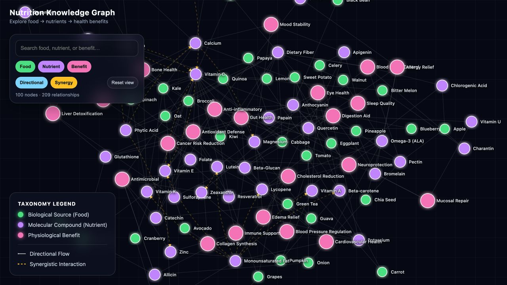

# Nutrition Knowledge Graph

> 用互動式知識圖譜探索「食物 → 營養素 → 健康效益」，並呈現營養素之間的協同與交互關係。

[線上體驗](https://momoko-1234.github.io/Nutrition-Knowledge-Graph/) · [回報問題](https://github.com/momoko-1234/Nutrition-Knowledge-Graph/issues) · [參與貢獻](CONTRIBUTING.md)



## 產品介紹

營養資訊通常散落在不同文章、資料庫與研究中。一般使用者可能知道某種食物「很健康」，卻不容易進一步理解：

- 這項食物含有哪些營養素？
- 營養素可能與哪些健康效益相關？
- 不同營養素之間是否存在促進、平衡或抑制關係？
- 如何從某個健康效益反向找到相關營養素與食物？

Nutrition Knowledge Graph 將這些資訊整理成可以搜尋、篩選與互動探索的關係網路。使用者可以從任意節點開始，查看直接相關的內容與關係方向，而不必逐篇拼湊資訊。

目前版本包含 **100 個節點**與 **209 條關係**：

| 類型 | 說明 | 介面顏色 |
| --- | --- | --- |
| Food | 食物與生物來源 | 綠色 |
| Nutrient | 維生素、礦物質與活性成分 | 紫色 |
| Health Benefit | 生理與健康效益 | 粉紅色 |
| Directional | 食物到營養素、營養素到效益 | 藍色實線 |
| Synergy | 營養素間協同或交互作用 | 黃色虛線 |

## 操作方式

### 搜尋與定位

在左上方搜尋框輸入食物、營養素或健康效益，例如 `Tomato`、`Vitamin C` 或 `Eye Health`。選取搜尋結果後，圖譜會自動聚焦並開啟節點詳情。

### 篩選內容

- `Food`、`Nutrient`、`Benefit`：控制顯示的節點類型。
- `Directional`：顯示具有方向性的營養關係。
- `Synergy`：顯示營養素間的協同與交互作用。

### 探索圖譜

- 點擊節點：高亮直接相關節點與關係，顯示詳情側欄。
- 拖曳節點：調整節點位置，方便閱讀密集區域。
- 拖曳空白區域：移動畫布。
- 滾輪或觸控手勢：縮放圖譜。
- `Reset view`：回到完整視角並清除目前選取。

手機版會將節點詳情改為底部面板，搜尋與篩選功能仍可使用。

## 核心功能

- D3.js 力導向知識圖譜
- 食物、營養素與健康效益三層關係
- 方向性與雙向協同關係
- 即時搜尋與自動定位
- 節點及關係類型篩選
- 相鄰節點高亮與非相關內容淡化
- 詳情側欄與關係清單
- 縮放、平移、節點拖曳與視角重設
- 響應式桌面及手機介面
- GitHub Pages 自動部署

## 專案檔案

- `index.html`：加入搜尋、篩選與響應式操作介面的網站首頁。
- `bidirectional_nutritional_graph.html`：最初的雙向營養知識圖譜原始檔。
- `CONTRIBUTING.md`：資料與功能貢獻說明。
- `gh-pages` branch：GitHub Pages 的網站發布版本。

## 在本機執行

本專案不需要安裝套件或建置工具：

```bash
git clone https://github.com/momoko-1234/Nutrition-Knowledge-Graph.git
cd Nutrition-Knowledge-Graph
python3 -m http.server 8000
```

瀏覽器開啟 [http://localhost:8000](http://localhost:8000)。由於 D3.js 從 CDN 載入，第一次開啟時需要網路連線。

## 啟用 GitHub Pages

Repository 已準備好 `gh-pages` 發布分支。Repository 擁有者只需設定一次：

1. 前往 **Settings → Pages**。
2. 在 **Build and deployment** 的 Source 選擇 **Deploy from a branch**。
3. Branch 選擇 **gh-pages**，資料夾選擇 **/ (root)**。
4. 按下 **Save**。

完成後網站會發布至 [https://momoko-1234.github.io/Nutrition-Knowledge-Graph/](https://momoko-1234.github.io/Nutrition-Knowledge-Graph/)。

## 參與開源專案

歡迎協助：

- 修正不正確或容易誤解的營養關係
- 提供可靠的研究或公共衛生來源
- 增加食物、營養素或健康效益節點
- 改善搜尋、無障礙、手機操作與翻譯
- 提出新的探索與視覺化方式

營養或健康資訊的修改必須附上可驗證來源。詳細規則請閱讀 [CONTRIBUTING.md](CONTRIBUTING.md)。

## 健康資訊聲明

本專案僅供教育與資訊探索，不提供疾病診斷、治療建議或個人化醫療服務。圖譜關係可能描述生物機制或研究相關性，不應直接視為個人健康建議。做出醫療決定前，請查證原始來源並諮詢合格醫療專業人員。

## License

程式碼採用 [MIT License](LICENSE)。貢獻者必須確保提交的內容與資料來源可以合法重新散布。
